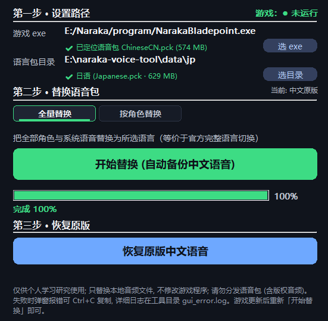
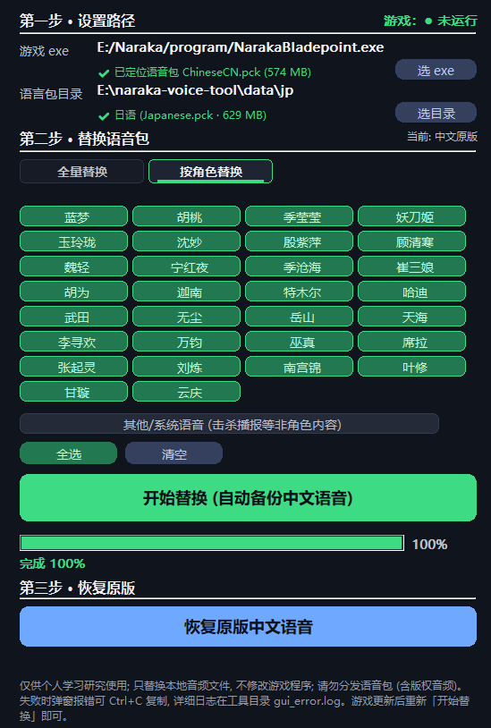

# 永劫无间 · 语音切换助手 (NarakaVoiceTool)

面向普通玩家的《永劫无间》语音包切换工具：**中文界面不变，把角色配音换成日语/英语**，支持全量替换或按角色挑选。

## 特性

- **三步向导**：选游戏 exe → 选语言包目录 → 一键替换，无需命令行
- **按角色替换**：30 位角色芯片式勾选，想换谁语言点谁（例如：只让蓝梦说日语，其他角色保持中文）
- **语言参考包**：日语 / 英语
- **自动备份与恢复**：首次替换自动备份中文原声，一键恢复；游戏更新后重跑一遍即可
- **安全防呆**：游戏运行中自动拒绝操作；备份永不被工具生成的语言包覆盖；失败时弹窗可复制报错并落盘日志
- **免安装**：单文件 exe，双击即可食用

## 使用步骤

### 第一步 · 设置路径
- **游戏 exe**：选择 `NarakaBladepoint.exe`（Steam / 官方启动器通用，工具会自动定位语音包）
- **语言包目录**：文件夹内含 `Japanese.pck` / `English.pck` 任一即可
  - Steam 玩家：游戏目录 `NarakaBladepoint_Data\StreamingAssets\Audio\GeneratedSoundBanks\Windows\` 里通常自带多语言 pck，把想要的语言复制到一个新文件夹再选它
  - 官网语言包：官方下载 zip 解压后选解压目录
  - 多个语言包同目录时会弹窗让你挑

### 第二步 · 替换语音包
- **全量替换**：全部角色与系统语音换成所选语言（等价官方完整语言切换）
- **按角色替换**：勾选想换的角色（可多选，「全选」可切换），其余保持中文
- 自动备份中文原声

### 第三步 · 恢复原版
- 一键恢复全中文语音

## 功能预览

| 全量替换 | 按角色替换 |
|:---:|:---:|
|  |  |

## 已知限制

- 游戏更新后语音变回中文属正常现象，重新「开始替换」即可（官方更新语音内容后需重新下载最新语言包）
- 口型动画按中文音节制作，替换后口型不完全对齐，属正常现象
- 泰语语言包的角色配音实为英语兜底（官方未制作泰语角色配音），换泰语 ≈ 换英语
- 新角色：当前版本已上线的角色语音已全部收录；后续新英雄需在 `src/roles.cpp` 角色表登记内部英文名（如 `lyam`/`kylin`）后重新编译，界面芯片与布局自动扩展
- 「恢复原版」依赖自动生成的备份文件（`ChineseCN.pck.bak`），请勿手动删除；误删可用 Steam「验证文件完整性」兜底

## 构建

VS2022 MSVC 环境。

## 免责声明

仅供个人学习研究使用。体验完毕后请尽快删除！严禁售卖！工具只将游戏音频资源替换为官方的另外语种官方语音，不修改游戏程序。**替换产生的语音包文件含版权音频，请勿分发**；请勿用于任何商业用途。若游戏文件校验异常，使用 Steam「验证文件完整性」即可还原。

## 授权

本项目代码以 [CC BY-NC 4.0](LICENSE) 授权：可自由使用、修改与分发，但**禁止任何商业用途**，
且修改 / 二次分发必须在显著位置保留原作者与仓库链接。
游戏音频版权归原厂商所有，替换产生的语音包文件请勿分发。
